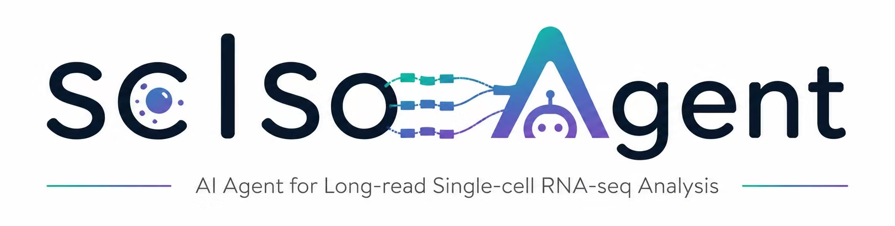

<p align="center">
  
</p>

# scIsoAgent User Guide

`scIsoAgent` is a portable workflow assistant for long-read single-cell RNA-seq analysis.

It supports:

- upstream processing from raw ONT or PacBio reads
- downstream analysis from quantified outputs and Seurat objects

This repository is a portable workflow bundle for long-read single-cell RNA-seq analysis.

## What This Bundle Contains 📦

The repository mainly includes:

- `skills/`: workflow modules
- `scripts/`: analysis scripts and helper scripts

Typical repository layout:

```text
README.md
scripts/
skills/
prompt_example.txt
```

For actual workflow use, the important requirement is that `skills/` and `scripts/` remain sibling directories.
`README.md` and `prompt_example.txt` are user-facing documentation files.

## What scIsoAgent Can Do

scIsoAgent currently supports:

- ONT long-read single-cell RNA-seq
- PacBio CCS long-read single-cell RNA-seq

### Upstream ⬆️

Upstream processing turns raw reads into transcript- or gene-level outputs.

#### ONT

```text
Raw FASTQ
  -> BLAZE
  -> minimap2
  -> samtools
  -> one of:
       - IsoQuant
       - bambu
       - FLAIR
```

#### PacBio

```text
Raw FASTQ
  -> one of:
       - IsoQuant
       - bambu
```

### Downstream ⬇️

Downstream analysis currently includes:

- resource setup
- gene-count splitting by sample
- empty-droplet removal
- QC
- sample merging and optional batch correction
- isoform-object generation and merging
- adding isoform assay into gene-level Seurat objects
- annotation
- feature plotting
- isoform exploration
- isoform classification
- isoform diversity analysis
- differential transcript usage
- transcript localization prediction and gene-specific localization exploration
- translation start/stop site prediction and gene-specific TIS/TTS visualization
- Orthrus-based sequence embedding and isoform functional prediction
- final cross-step summary and optional discussion-style interpretation

## How To Use It 🚀

In normal use:

- tell the agent what you want to do
- say whether you are starting from raw data or from existing outputs
- provide the main input paths
- make sure the required Docker image is available locally
- confirm the proposed command before execution

Examples:

- "Run the upstream ONT workflow from these FASTQ files"
- "Start downstream analysis from this merged Seurat object"
- "Run only IsoQuant on these aligned BAM files"
- "Plot these genes on the merged object"

## Docker Environment

scIsoAgent expects the workflow environment to come from the published Docker image.

### 1. Pull Docker image

```bash
docker pull chengzhizhaofd/scisoagent:latest
```

### 2. Run the Docker container

Run scIsoAgent in interactive mode:

```bash
docker run -it --name scisoagent chengzhizhaofd/scisoagent:latest /bin/bash
```

Recommended: mount a local project directory

```bash
docker run -it \
  -v /path/to/your/project:/work \
  --name scisoagent \
  chengzhizhaofd/scisoagent:latest /bin/bash
```

Inside the container, work under:

```text
/work
```

Typical workflow inside the container:

```bash
cd /work
git clone https://github.com/zczali4403/scIsoAgent.git
cd scIsoAgent
mkdir .pi
mv scripts .pi/
mv skills .pi/
pi
```

The Docker image already includes `pi`, so no additional installation step is required inside the container.

Start `pi` from `/work` so the agent can discover the repository content from the mounted working directory.

After that, work inside the repository directory and keep `skills/` and `scripts/` as sibling directories.

Use this image as the default execution environment for both upstream and downstream analysis. The required analysis software has been packaged into this image.

## How Outputs Are Organized 📁

scIsoAgent uses one top-level `results` directory for a workflow run. This is a runtime output directory and may be created when a run starts.

You confirm that root once, and each step then creates its own subdirectory under it.

Typical default subdirectory names:

- `01_blaze`
- `02_minimap2`
- `03_samtools`
- `04_isoquant`
- `04_flair`
- `04_bambu`
- `05_resource_setup`
- `06_split_gene_count`
- `07_remove_droplets`
- `08_qc_pipeline`
- `09_merge_remove_batch`
- `10_generate_iso_obj`
- `11_merge_iso_obj`
- `12_add_iso_to_gene`
- `13_annotation`
- `14_draw_features`
- `14_explore_isoforms`
- `14_isoform_classification`
- `14_isoform_diversity`
- `14_dtu`
- `15_transcript_localization`
- `15_tis_tts_analysis`
- `15_orthrus_model`
- `16_summary`

## What You Should Prepare 📝

Depending on the task, you may need some or all of the following:

Note: input files do not need to live under a repository-owned `data/` directory. Users can organize inputs wherever they want and pass the real paths at runtime.

- raw FASTQ files
- aligned BAM files
- reference genome FASTA
- reference annotation GTF or GFF
- quantified transcript or gene matrices
- Seurat RDS objects
- Docker installed locally with access to `chengzhizhaofd/scisoagent:latest`

For downstream work, it is also helpful to know:

- which results directory you want to use
- which Seurat object should be the main input
- which metadata columns represent sample, condition, cluster, or cell type

## Typical Starting Points 🧭

### Start From Raw Data

If you are starting from raw reads, provide:

- platform: `ONT` or `PacBio`
- input file paths
- reference FASTA
- annotation GTF or GFF
- top-level results directory

### Start From Existing Outputs

If you already completed part of the workflow, provide:

- which outputs already exist
- where they are located
- which downstream step you want next

Common starting points include:

- merged gene count matrix
- per-sample count matrices
- Seurat RDS after droplet removal
- QC-completed Seurat objects
- merged Seurat object with isoform assay

## Portability

If you want to move this workflow bundle to another machine or another project location:

- copy the whole bundle
- keep `skills/` and `scripts/` as sibling directories

Do not copy only `skills/` without `scripts/`.

## Summary ✅

Use this workflow bundle if you want a structured way to run long-read scRNA-seq analysis in this repository.

The basic pattern is:

- start from your real input files or existing outputs
- confirm one top-level results directory
- let each workflow step create its own subdirectory
- review and confirm commands before they run

If you are unsure where to begin, describe your current inputs and your goal.
